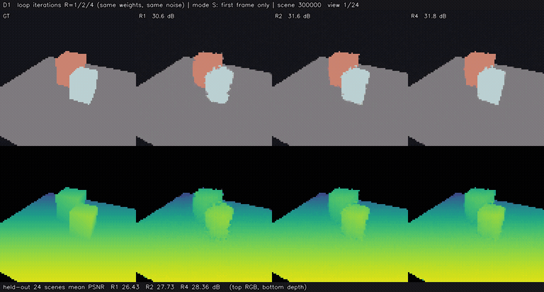
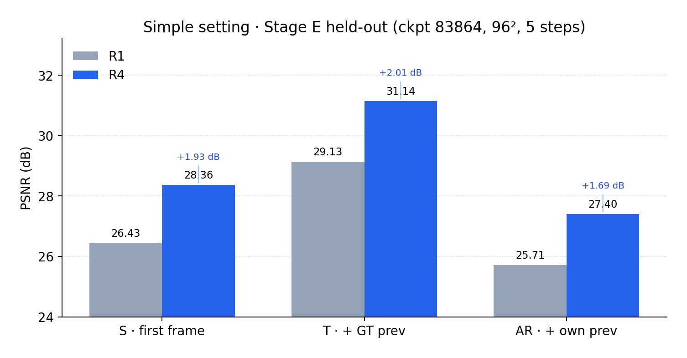
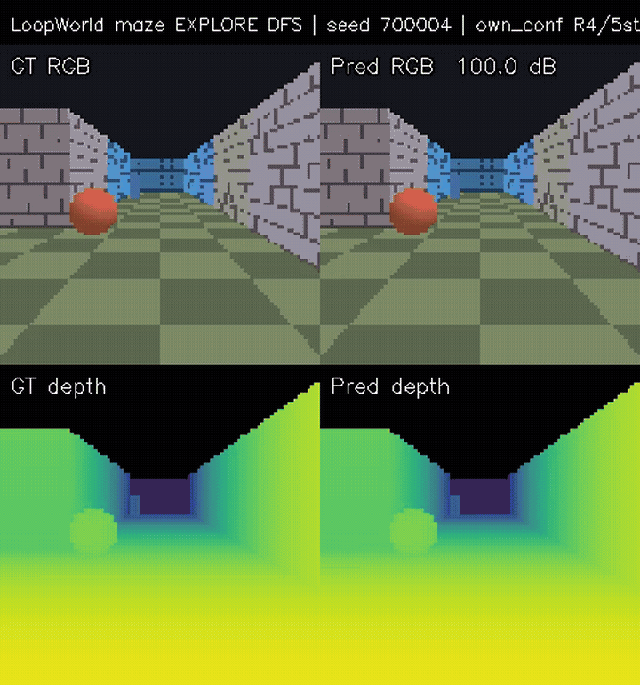
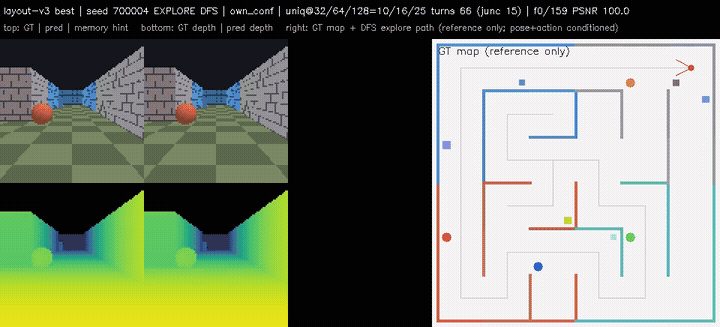

# LoopWorld

**A complete, from-scratch build of a world model on a single RTX 4090.**

A **46M-parameter** camera-conditioned **RGB-D** model trained from scratch to predict novel views from posed observations — then extended to **128-step maze rollouts** with discrete actions and geometric memory. Same codebase, synthetic static scenes at **96²**, one card end to end.

First-frame conditioning is **RGB-D + camera pose** (Plücker rays). Maze demos are **camera/action-conditioned** rollouts (DFS paths planned on the GT map) — not autonomous planning.

<p align="center">
  
</p>
<p align="center"><em>Same weights, more loops: R1 / R2 / R4 side by side (orbit)</em></p>

---

## Key findings

1. **Loops buy autoregressive quality.** Same checkpoint, 24 held-out orbit scenes: R1→R4 adds **+1.68 dB** AR PSNR (raw JSON; Stage E, 5 Euler steps). See [`results/orbit_stage_e_step083864.json`](results/orbit_stage_e_step083864.json).
2. **Loop depth has a useful range.** An R×steps grid peaks near **R4 + 2 Euler steps**; R6/R8 (beyond the train depth of 4) degrade AR. Loops beat spending the same budget on more denoising steps alone.
3. **Revisit self-consistency ≠ scene correctness.** A model can recreate its own earlier (wrong) layout at high PSNR. Oracle-history experiments show **substantial sensitivity to rollout and memory fidelity** — they diagnose the system; they do not prove a write-only bottleneck.

---

## Quick start

Install, smoke-check, train on one 4090, then point demos and evals at your EMA with `--ckpt` / `--init`. Headline numbers below are backed by published JSON under [`results/`](results/) — reprint them on CPU with `print_result_tables.py`.

```bash
git clone https://github.com/NeuraLiying/LoopWorld.git
cd LoopWorld
# install — see Requirements below

# Geometry / interface smoke
python scripts/run_stage_a_checks.py

# Reprint published tables from results/*.json (CPU, no checkpoint)
python scripts/print_result_tables.py

# Orbit starter train on one 4090 (~1 hour wall for the published YAML)
python scripts/run_stage_d_main.py \
  --config configs/r1_main_768_96.yaml \
  --device cuda:0 --batch-size 16 --tag my_run

# After training:
python scripts/make_orbit_demo.py \
  --ckpt path/to/your_ema.pt \
  --out exp_records/my_orbit

python scripts/stage_e_eval.py \
  --ckpt path/to/your_ema.pt \
  --out exp_records/my_stage_e \
  --modes S,T,AR --Rs 1,2,4
```

Maze train → eval → explore demo entrypoints are under [Train](#train).

---

## Results

### Orbit · Stage E (24 held-out, 5 Euler steps)

Checkpoint: EMA at step **83864** (multi-continuation Stage D).

| Mode | Conditioning | R4 PSNR | Loop gain R4−R1 | AbsRel |
|---|---|---|---|---|
| **S** | GT first RGB-D frame | **28.36** | **+1.93 dB** | 0.026 |
| **T** | First frame + GT previous | **31.14** | +2.01 dB | 0.012 |
| **AR** | First frame + own previous | **27.40** | **+1.68 dB** | 0.032 |

<p align="center">
  
</p>

| Demo | File |
|---|---|
| Loop split (R1/R2/R4) | [`docs/media/simple_orbit/D1_loop_R1_R2_R4_split.gif`](docs/media/simple_orbit/D1_loop_R1_R2_R4_split.gif) |
| AR PSNR vs view | [`docs/media/simple_orbit/D3_psnr_curve.png`](docs/media/simple_orbit/D3_psnr_curve.png) |
| Four-panel orbit (RGB-D) | [`docs/media/simple_orbit/orbit_demo_step083864_h264.mp4`](docs/media/simple_orbit/orbit_demo_step083864_h264.mp4) |

Raw JSON: [`results/orbit_stage_e_step083864.json`](results/orbit_stage_e_step083864.json) · R×steps grid: [`results/orbit_loop_rxsteps_grid.json`](results/orbit_loop_rxsteps_grid.json).

### Maze · actions + geometric memory (32 test seeds 700000–700031)

Same layout EMA, protocol **R4 / 5 steps / T=128 / own_conf**. Paths are **DFS explorations** planned on the GT map; the model receives pose and discrete actions.

| Memory | AR full | Revisit vs GT |
|---|---|---|
| **Own (confidence-weighted)** | **20.22** | **21.10** |
| Oracle (GT-integrated history) | 33.24 | 35.23 |

<p align="center">
  
</p>
<p align="center"><em>Clean teaser — model RGB-D rollout + path (seed 700004, DFS, own_conf). Map is GT reference only.</em></p>

<p align="center">
  
</p>
<p align="center"><em>Diagnostic panel — GT / pred / memory / depth (same trajectory). Prefer the clean teaser on a first pass.</em></p>

| Demo | File |
|---|---|
| DFS clean (recommended teaser) | [`docs/media/maze/layout_explore_clean.gif`](docs/media/maze/layout_explore_clean.gif) |
| DFS diagnostic (six-panel) | [`docs/media/maze/layout_explore_diag.gif`](docs/media/maze/layout_explore_diag.gif) |
| Earlier SF own-memory AR | [`docs/media/maze/sf_ar_own_memory.gif`](docs/media/maze/sf_ar_own_memory.gif) |

JSON: [`results/maze_layout_test_seeds700000_700031.json`](results/maze_layout_test_seeds700000_700031.json).

*Layout continues from action → memory → self-forcing (continued training), not a standalone from-scratch maze run. Stage figures: [`docs/technical_report.md`](docs/technical_report.md).*

---

## Architecture (four clocks)

Keep these distinct when reading the code or papers:

| Dial | Symbol | Meaning |
|---|---|---|
| Transformer loops | **R** | Shared-weight DiT core iterations (train R=4; eval R1/R2/R4) |
| Flow steps | **S** | Rectified-flow Euler steps per generated view |
| Autoregressive time | **t** | Frame index in a rollout |
| Geometric memory | read/write | Lift RGB-D → world points → reproject into the target camera |

**Loop mechanics:** 1 pre + 2 shared core + 1 post (~46M). The next loop consumes the hidden state **after the core** (not after the post). Every loop exit is supervised in training.

---

## Why loop

Parameters stay fixed; **R** is a quality/latency dial. Three measured points (beyond “more loops look better”):

1. **Loop gain grows with training** on the 24-scene Stage E protocol (5 Euler steps, step 83864): R4−R1 ≈ **+1.93 / +2.01 / +1.68 dB** on S / T / AR.
2. **On this flow world model, loops beat extra denoising steps.** The R×steps grid peaks at **R4 with 2 Euler steps** (S **29.26**, AR **27.91**); R1 with 10 steps is only ~**25.5** on S.
3. **R is not unbounded.** Training depth is 4; R6/R8 especially hurt AR (R8 AR ~**24.6**).

---

## Key design choices

- **Shared-weight loop DiT (R1→R4).** Extra compute from iterations, not parameters; every exit supervised (`train_loops: 4`).
- **Rectified flow + few Euler steps.** Straight-line velocity; Stage E uses 5 steps so long AR rollouts stay cheap.
- **RGB-D prediction.** Depth is an explicit geometric target and enables point memory.
- **Plücker-ray pose conditioning.** Dense, resolution-aligned cameras — not a single global pose vector.
- **QK-Norm + fp32 attention logits.** Keeps long resumed runs finite; log max attention logit as a health signal.
- **S / T / AR split.** Separates single-frame quality from error accumulation; **AR** is the headline.
- **Action conditioning via AdaLN (mazes).** Discrete moves injected every block; init so control starts as a residual on the loaded checkpoint.
- **Geometric point memory.** z-buffered reprojection with light splatting; own vs oracle history for diagnosis.
- **Self-forcing + layout curriculum.** Train on EMA rollouts; oversample hard/turn frames; confidence-weight memory reads.
- **Single-24GB-GPU profiling.** 96² / width 768 / batch 16 saturates one 4090; profile before scaling batch.

---

## Takeaways

- **High revisit self-consistency ≠ correct memory.** The model can stably recreate its own earlier wrong layout.
- **Oracle-history experiments reveal substantial sensitivity to rollout and memory fidelity.** They are a diagnostic upper bound, not a claim that writing is the only bottleneck.
- **Training-recipe gains saturate.** Self-forcing and layout help; further closed-loop gains need better geometry write/read, not endless recipe tweaks.
- **Watch attention logits before long runs.** After QK-Norm, max logits stay ~**18**; earlier runs hit ~**1e7** while loss still looked fine.

---

## Attribution

Inspired by **Atlas** and **Genie** (camera/action-conditioned world models at scale). LoopWorld is an independent from-scratch implementation: procedural RGB-D data, looped DiT + rectified flow, Plücker conditioning, maze actions, geometric memory, and the experiments above were built and run for this project.

---

## Requirements & installation

| | |
|---|---|
| **Python** | 3.10 (3.10–3.11 tested) |
| **PyTorch** | ≥ 2.4 with CUDA (tested 2.4.0 + cu121) |
| **GPU** | One 24 GB GPU (e.g. RTX 4090) |
| **Python deps** | see [`requirements.txt`](requirements.txt) |
| **System** | `ffmpeg` with `libx264` — demo video export only |

```bash
conda create -n loopworld python=3.10 -y && conda activate loopworld
pip install torch --index-url https://download.pytorch.org/whl/cu121
pip install -r requirements.txt
# ffmpeg: apt / conda-forge / brew
```

---

## Train

```bash
# Geometry / interface smoke
python scripts/run_stage_a_checks.py

# Orbit main train (96², width 768)
python scripts/run_stage_d_main.py \
  --config configs/r1_main_768_96.yaml \
  --device cuda:0 --batch-size 16 --tag my_run

# Maze: action → memory → self-forcing → layout
python scripts/run_maze_v2_train.py --device cuda:0
python scripts/run_maze_v2_mem_train.py --device cuda:0 --init path/to/action_ckpt.pt
python scripts/run_maze_v2_sf_train.py --device cuda:0 --init path/to/mem_ckpt.pt
python scripts/run_maze_v3_layout_train.py --device cuda:0 --init path/to/sf_ckpt.pt

python scripts/maze_mem_diag.py --ckpt path/to/mem_ckpt.pt --out exp_records/my_mem_diag
```

---

## Repo layout

```text
loopworld/           # Python package (orbit + maze + memory)
configs/             # Train recipes
scripts/             # Train / eval / demo entrypoints
results/             # Published eval JSON (verifiable tables)
weights/             # MODEL_CARD + SHA256SUMS (run fingerprints)
docs/
  media/             # Figures, GIFs, H.264 demos
  technical_report.md
  STORY.zh.md
```

---

## Further reading

- [`docs/technical_report.md`](docs/technical_report.md) — stage chronology, maze progression figures, eval protocols
- [`docs/media/MEDIA_MANIFEST.md`](docs/media/MEDIA_MANIFEST.md) — why each media asset is included
- [`docs/STORY.zh.md`](docs/STORY.zh.md) — Chinese narrative

---

## Citation

```bibtex
@software{loopworld2026,
  title  = {LoopWorld: A Looped RGB-D World Model, from Orbits to Interactive Mazes},
  author = {Li, Ying},
  year   = {2026},
  url    = {https://github.com/NeuraLiying/LoopWorld}
}
```

## License

[MIT](LICENSE)
