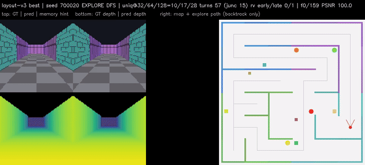
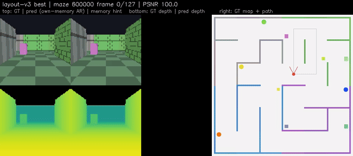

# LoopWorld

**One RTX 4090. From-scratch training. A looped world-model baseline you can actually run.**

Shared-weight **loop DiT**: at inference, spend more compute (R1→R4) and measured quality goes up. The **same codebase** covers a **simple setting** (synthetic orbit scenes) and a **more complex setting** (action-driven mazes + geometric memory)—with numbers, figures, and demos for both.

<p align="center">
  
</p>
<p align="center"><em>Simple setting — same weights, more loops: R1 / R2 / R4 side by side</em></p>

---

## Why this project

| Capability | What you get |
|---|---|
| **Loops buy quality** | Same weights; R4−R1 ≈ **+1.9 dB** on the simple Stage E protocol |
| **RGB-D + geometry** | Predict RGB and metric depth; orbit demos show GT vs prediction |
| **S / T / AR eval** | First-frame / teacher-forced / autoregressive—reported separately |
| **Interactive mazes** | Discrete actions, 128-frame episodes, revisit consistency |
| **Memory read pathway** | Own vs oracle memory: clean memory lifts AR to ~29–33 dB |
| **Single-GPU reproducible** | 96², ~46M params, batch 16, one 4090; QK-Norm for long runs |

Synthetic data at 96²—intentionally a **single-card, from-scratch workspace**, not a closed-source showcase.

---

## Simple setting · synthetic orbit

Procedural geometry rooms + known camera orbits. Best checkpoint: `ckpt_final_step083864.pt`.

### Stage E results (24 held-out, 5 Euler steps)

| Mode | Conditioning | R4 PSNR | Loop gain R4−R1 | AbsRel |
|---|---|---|---|---|
| **S** | GT first frame | **28.36** | **+1.93 dB** | 0.026 |
| **T** | First frame + GT previous | **31.14** | +2.01 dB | 0.012 |
| **AR** | First frame + own previous | **27.40** | +1.69 dB | 0.032 |

<p align="center">
  
</p>

| Demo | File |
|---|---|
| Loop split (R1/R2/R4) | [`docs/media/simple_orbit/D1_loop_R1_R2_R4_split.gif`](docs/media/simple_orbit/D1_loop_R1_R2_R4_split.gif) |
| AR PSNR vs view | [`docs/media/simple_orbit/D3_psnr_curve.png`](docs/media/simple_orbit/D3_psnr_curve.png) |
| Four-panel orbit (RGB-D) | [`docs/media/simple_orbit/orbit_demo_step083864_h264.mp4`](docs/media/simple_orbit/orbit_demo_step083864_h264.mp4) |

---

## Complex setting · maze + action + memory

Same code lineage: procedural mazes, discrete actions, 128-frame trajectories, revisit protocol, geometric memory. Not on the same absolute scale as short orbits—here we report progression under the maze protocol and the memory-read upper bound.

### Progression (32 test mazes, fixed noise seed)

| Stage | Setup | AR full | Revisit vs GT |
|---|---|---|---|
| Action | Actions, no memory | 16.20 | 15.72 |
| Geom. memory | Memory slots | 17.51 | 17.01 |
| Self-forcing | Train on own memory | 18.98 | 19.05 |
| Layout best | Hard-frame curriculum + conf | **19.43** | **19.67** |

<p align="center">
  
</p>

<p align="center">
  
</p>
<p align="center"><em>Complex setting — maze exploration (first-person + path)</em></p>

### Memory read upper bound

| Memory write | AR full |
|---|---|
| Memory off | 15.12 |
| Own (predicted integrate) | 17.51 |
| **Oracle (GT integrate)** | **28.59** |
| Oracle + GT previous | 35.65 |

<p align="center">
  
</p>

Clean memory gives about **+11 dB** vs own—the read pathway works. Self-forcing / layout push closed-loop own memory to ~19; oracle sits around 29–33.

| Demo | File |
|---|---|
| Maze explore | [`docs/media/maze/layout_explore.gif`](docs/media/maze/layout_explore.gif) |
| Layout best closed-loop AR | [`docs/media/maze/layout_best.gif`](docs/media/maze/layout_best.gif) |
| Self-forcing own-memory AR | [`docs/media/maze/sf_ar_own_memory.gif`](docs/media/maze/sf_ar_own_memory.gif) |

<p align="center">
  
</p>

---

## Quick start

```bash
git clone https://github.com/NeuraLiying/LoopWorld.git
cd LoopWorld

# CUDA PyTorch recommended (example)
# pip install torch --index-url https://download.pytorch.org/whl/cu121
pip install -r requirements.txt

# Geometry / interface smoke
python scripts/run_stage_a_checks.py

# Simple setting — main train (96², width 768)
python scripts/run_stage_d_main.py \
  --config configs/r1_main_768_96.yaml \
  --device cuda:0 \
  --batch-size 16 \
  --tag my_run

# Simple setting — Stage E eval (S/T/AR × R)
python scripts/stage_e_eval.py \
  --ckpt path/to/ckpt_final_step083864.pt \
  --out exp_records/my_stage_e \
  --modes S,T,AR --Rs 1,2,4

# Orbit demo
python scripts/make_orbit_demo.py --ckpt path/to/ckpt.pt --out exp_records/my_orbit

# Complex setting — maze action → memory → self-forcing → layout
python scripts/run_maze_v2_train.py --device cuda:0
python scripts/run_maze_v2_mem_train.py --device cuda:0 --init path/to/action_ckpt.pt
python scripts/run_maze_v2_sf_train.py --device cuda:0 --init path/to/mem_ckpt.pt
python scripts/run_maze_v3_layout_train.py --device cuda:0 --init path/to/sf_ckpt.pt

# Memory diagnosis (own / oracle / nomem)
python scripts/maze_mem_diag.py --ckpt path/to/mem_ckpt.pt --out exp_records/my_mem_diag
```

Checkpoints are not shipped in this repo (large). Train locally or point `--ckpt` / `--init` at your own weights.

---

## Repo layout

```text
loopworld/          # Python package (orbit + maze + memory)
configs/            # Published train recipes (incl. r1_main_768_96.yaml)
scripts/            # Train / eval / demo entrypoints only
docs/
  media/            # Curated figures, GIFs, H.264 demos
  KNOWHOW.md        # Training & eval recipes
  STORY.zh.md       # Chinese release narrative
  design/           # Design & diagnosis notes
```

---

## Know-how

Practical notes for long runs, S/T/AR reading, and own/oracle memory pairs:

- **[docs/KNOWHOW.md](docs/KNOWHOW.md)** — QK-Norm + fp32 softmax, eval modes, memory diagnosis, depth metrics, single-GPU util
- **[docs/design/](docs/design/)** — instability diagnosis, geometric memory, self-forcing, layout curriculum, maze eval protocol
- **[docs/media/MEDIA_MANIFEST.md](docs/media/MEDIA_MANIFEST.md)** — why each media asset is included
- **[docs/STORY.zh.md](docs/STORY.zh.md)** — full Chinese story draft

---

## Citation

If you use LoopWorld, please cite this repository.

```bibtex
@software{loopworld2026,
  title  = {LoopWorld: Looped RGB-D World Model Baseline},
  author = {Li, Ying},
  year   = {2026},
  url    = {https://github.com/NeuraLiying/LoopWorld}
}
```

## License

[MIT](LICENSE)
