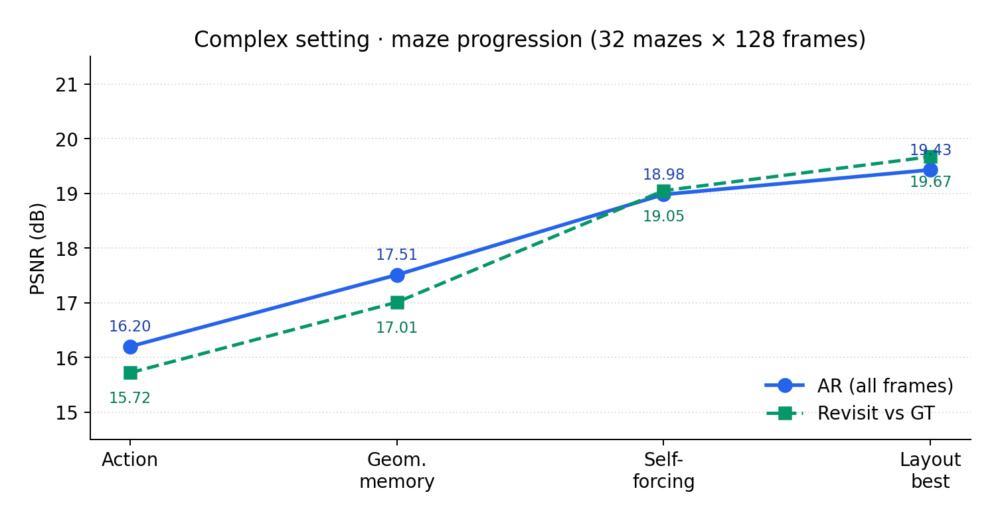
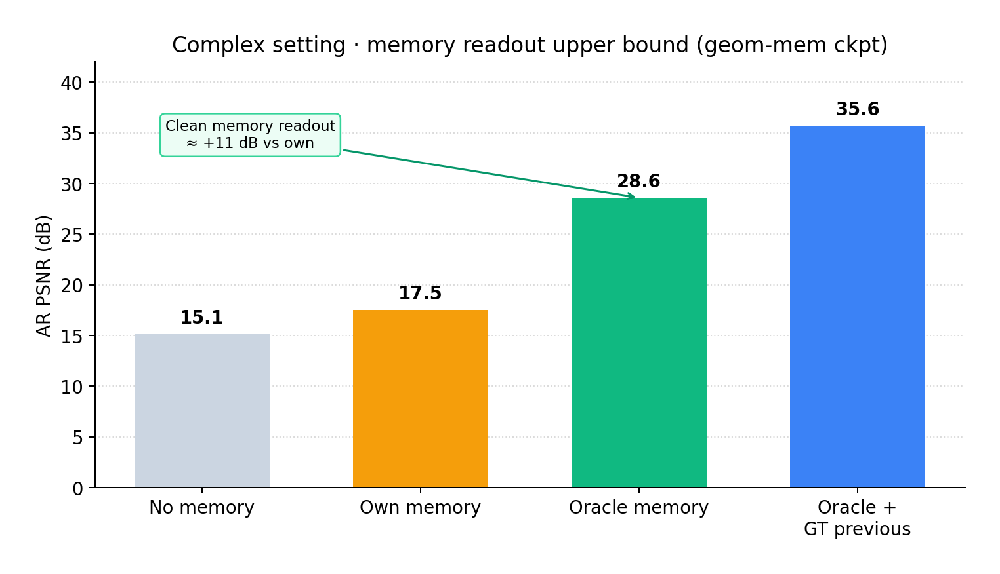

# LoopWorld · GitHub 发布故事稿

> 中文发布叙事。媒体见 [`media/MEDIA_MANIFEST.md`](media/MEDIA_MANIFEST.md)；配方见 [`KNOWHOW.md`](KNOWHOW.md)。

---

## Hook

**一张 RTX 4090，从零训通可交互的循环世界模型基线。**

共享权重 loop DiT：推理时多跑几圈（R1→R4），质量可测上升。同一套代码，先在 **简单设定**（合成场景环绕）上把循环增益与 S/T/AR 评测跑通，再接到 **复杂设定**（动作驱动迷宫 + 几何记忆）：更长轨迹、可回访，并用 oracle 记忆标出读记忆通路的能力上界。

配套：数字图、精选 GIF/H.264、可复现命令与训练/评测配方。

---

## 它能做什么

| 能力 | 说明 |
|---|---|
| **循环换质量** | 同权多 loop；简单设定上 R4−R1 约 **+1.9 dB** |
| **RGB-D + 几何条件** | 预测 RGB 与度量深度；四栏轨道 demo 可直观对照 |
| **S / T / AR 评测** | 首帧 / +GT 前帧 / 自回归分报，指标可读 |
| **迷宫交互** | 离散动作、128 帧、回访一致性；点云几何记忆可接入 |
| **记忆读通路上界** | own 与 oracle 成对：干净记忆下 AR 可达 ~29–33 dB |
| **单卡可复现** | 96²、~46M、batch 16、一张 4090；QK-Norm 支撑长训 |

设定：合成数据、96²。这是单卡可从头复现的工作区。

---

## 简单设定 · 合成环绕

程序化几何体房间 + 已知相机轨道。最佳 ckpt：`ckpt_final_step083864.pt`。

### 结果（Stage E，24 held-out，5 Euler steps）

| 模式 | 条件 | R4 PSNR | 循环增益 R4−R1 | AbsRel |
|---|---|---|---|---|
| **S** | GT 首帧 | **28.36** | **+1.93 dB** | 0.026 |
| **T** | 首帧 + GT 前帧 | **31.14** | +2.01 dB | 0.012 |
| **AR** | 首帧 + 自身前帧 | **27.40** | +1.69 dB | 0.032 |


### 媒体

| 目的 | 路径 |
|---|---|
| R1/R2/R4 分屏（循环换质量） | `media/simple_orbit/D1_loop_R1_R2_R4_split.gif` |
| AR 随视角 PSNR | `…/simple_orbit/D3_psnr_curve.png` |
| 四栏轨道 demo | `…/simple_orbit/orbit_demo_step083864_h264.mp4` |

---

## 复杂设定 · 迷宫 + 动作 + 记忆

同一代码谱系：过程式迷宫、离散动作、128 帧、回访协议、几何记忆。与短环绕不在同一绝对标尺上比；这里报迷宫协议下的递进，以及记忆读通路上界。

### 递进（32 测试迷宫，同一噪声种子）

| 阶段 | 设定 | AR 全段 | 回访 vs GT |
|---|---|---|---|
| Action | 动作，无记忆 | 16.20 | 15.72 |
| Geom. memory | 记忆槽 | 17.51 | 17.01 |
| Self-forcing | 训练见 own 记忆 | 18.98 | 19.05 |
| Layout best | 难帧课程 + conf | **19.43** | **19.67** |



### 记忆读通路上界

| 记忆写入 | AR 全段 |
|---|---|
| 关闭记忆 | 15.12 |
| Own（预测积分） | 17.51 |
| **Oracle（GT 积分）** | **28.59** |
| Oracle + GT 前帧 | 35.65 |



own 与 oracle 成对读：干净记忆约 **+11 dB**，说明读记忆通路成立；self-forcing / layout 把闭环 own 推到 ~19，oracle 约 32–33。

### 媒体

| 目的 | 路径 |
|---|---|
| 迷宫探索主视觉 | `media/maze/layout_explore.gif` |
| Layout best 闭环 AR | `…/maze/layout_best.gif` |
| SF own-memory AR | `…/maze/sf_ar_own_memory.gif` |

---

## 快速开始

```bash
cd /path/to/loopworld
conda activate loopworld

# 简单设定
python scripts/run_stage_d_main.py --config configs/r1_main_768_96.yaml --device cuda:0
python scripts/stage_e_eval.py --ckpt path/to/ckpt_final_step083864.pt --out exp_records/my_e --modes S,T,AR --Rs 1,2,4
python scripts/demos/make_demos.py --ckpt path/to/ckpt_final_step083864.pt --out exp_records/my_demos

# 复杂设定（迷宫）：见 scripts/run_maze_v2_train.py、maze_mem_diag.py、maze_sf_full_eval.py
```

---

## Know-how

- 配方：[`KNOWHOW.md`](KNOWHOW.md)  
- 稳定化：[`design/instability_diagnosis_20261013.md`](design/instability_diagnosis_20261013.md)、[`design/qk_norm_fp32_change_20261013.md`](design/qk_norm_fp32_change_20261013.md)  
- 迷宫评测：[`design/maze_mem_diagnosis_20261014.md`](design/maze_mem_diagnosis_20261014.md)、[`design/maze_sf_eval_20261015.md`](design/maze_sf_eval_20261015.md)、[`design/maze_layout_vs_sf_20261015.md`](design/maze_layout_vs_sf_20261015.md)  
- 媒体用途：[`media/MEDIA_MANIFEST.md`](media/MEDIA_MANIFEST.md)

---

## 嵌入路径速查（相对仓库根）

```
docs/media/figures/fig_simple_stage_e.png
docs/media/figures/fig_maze_progression.png
docs/media/figures/fig_maze_oracle_memory.png
docs/media/simple_orbit/D1_loop_R1_R2_R4_split.gif
docs/media/simple_orbit/D3_psnr_curve.png
docs/media/simple_orbit/orbit_demo_step083864_h264.mp4
docs/media/maze/layout_explore.gif
docs/media/maze/layout_best.gif
docs/media/maze/sf_ar_own_memory.gif
```
